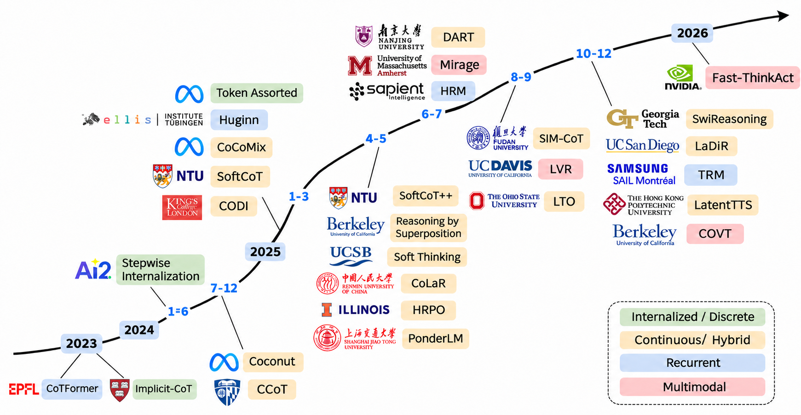

## Awesome Latent Thought — Papers, Models & Research on Reasoning Beyond Language

> Contributions of relevant papers, models, code, and benchmarks are welcome.

## 📖 Contents

- [🗺️ Overview](#️-overview)
- [📄 Paper List](#-paper-list)
  - [Implicit CoT Distillation](#implicit-cot-distillation)
  - [Continuous Thought Representations](#continuous-thought-representations)
  - [Adaptive Latent Reasoning](#adaptive-latent-reasoning)
  - [Latent Search](#latent-search)
  - [Recurrent Reasoning Models](#recurrent-reasoning-models)
  - [Theory, Interpretability, Evaluation](#theory-interpretability-evaluation)
  - [Multimodal Latent Reasoning](#multimodal-latent-reasoning)
  - [Surveys](#surveys)
- [Star History](#star-history)

## 🗺️ Overview

A curated collection of research on **latent reasoning, continuous thoughts, and implicit chain-of-thought**, including related models, code, and benchmarks.

The collection covers methods, training, inference-time computation, interpretability, evaluation, and multimodal extensions involving reasoning in latent states. Ordinary textual chain-of-thought and generic model acceleration are outside its core scope.

  

## 📄 Paper List

<!-- BEGIN BIBLIOGRAPHY CATALOG -->

### Implicit CoT Distillation

Internalize explicit reasoning in model weights or compress it into supervised latent states; direct-answer distillation does not by itself establish stepwise latent computation.

| Date | Name | Title | Conference / Journal | Paper | Github |
|:-:|:-:|:-|:-:|:-:|:-:|
| 2025-10 | `SemCoT` | **SemCoT: Accelerating Chain-of-Thought Reasoning through Semantically-Aligned Implicit Tokens** | [NeurIPS 2025](https://proceedings.nips.cc/paper_files/paper/2025/hash/3ddbd473456a57e3cafb1ee51ddf8ff6-Abstract-Conference.html) |  |  |
| 2025-09 | `SIM-CoT` | **SIM-CoT: Supervised Implicit Chain-of-Thought** | [ICLR 2026](https://proceedings.iclr.cc/paper_files/paper/2026/hash/5d087955ee13fe9a7402eedec879b9c3-Abstract-Conference.html) |  |  |
| 2025-06 | `DART` | **DART: Distilling Autoregressive Reasoning to Silent Thought** | [EMNLP 2025](https://aclanthology.org/2025.emnlp-main.256/) |  | — |
| 2025-02 | `CODI` | **CODI: Compressing Chain-of-Thought into Continuous Space via Self-Distillation** | [EMNLP 2025](https://aclanthology.org/2025.emnlp-main.36/) |  |  |
| 2024-12 | `CCoT` | **Compressed Chain of Thought: Efficient Reasoning Through Dense Representations** | arXiv preprint |  | — |
| 2024-09 | `HCoT` | **Expediting and Elevating Large Language Model Reasoning via Hidden Chain-of-Thought Decoding** | arXiv preprint |  | — |
| 2024-07 | `System-2 Distillation` | **Distilling System 2 into System 1** | arXiv preprint |  | — |
| 2024-05 | `Stepwise Internalization` | **From Explicit CoT to Implicit CoT: Learning to Internalize CoT Step by Step** | arXiv preprint |  |  |
| 2023-11 | `Implicit-CoT` | **Implicit Chain of Thought Reasoning via Knowledge Distillation** | arXiv preprint |  |  |

### Continuous Thought Representations

Represent intermediate thoughts with hidden vectors, soft token mixtures, or learned continuous concepts.

| Date | Name | Title | Conference / Journal | Paper | Github |
|:-:|:-:|:-|:-:|:-:|:-:|
| 2026-06 | `NF-CoT` | **Latent Reasoning with Normalizing Flows** | [ICLR 2027 (under review)](https://openreview.net/forum?id=jBge92WJps) |  | — |
| 2025-10 | `Latent-SFT` | **LLM Latent Reasoning as Chain of Superposition** | arXiv preprint |  |  |
| 2025-09 | `MarCos` | **Deep Thinking by Markov Chain of Continuous Thoughts** | arXiv preprint |  |  |
| 2025-05 | `Soft Thinking` | **Soft Thinking: Unlocking the Reasoning Potential of LLMs in Continuous Concept Space** | [NeurIPS 2025](https://proceedings.neurips.cc/paper_files/paper/2025/file/f7396d1c54d51416958d63e285377103-Paper-Conference.pdf) |  |  |
| 2025-05 | `Latent Tokens` | **Enhancing Latent Computation in Transformers with Latent Tokens** | arXiv preprint |  | — |
| 2025-02 | `SoftCoT` | **SoftCoT: Soft Chain-of-Thought for Efficient Reasoning with LLMs** | [ACL 2025](https://aclanthology.org/2025.acl-long.1137/) |  |  |
| 2025-02 | `CoCoMix` | **LLM Pretraining with Continuous Concepts** | [ICLR 2026](https://www.microsoft.com/en-us/research/publication/llm-pretraining-with-continuous-concepts/) |  |  |
| 2024-12 | `Coconut` | **Training Large Language Models to Reason in a Continuous Latent Space** | [COLM 2025](https://proceedings.colm.cc/paper_files/paper/2025/hash/ed032b08a8822c3635cdcd961012ce60-Abstract-Conference.html) |  |  |

### Adaptive Latent Reasoning

Combine latent and textual computation, including discrete latent codes, adaptive compression, routing, and stopping.

| Date | Name | Title | Conference / Journal | Paper | Github |
|:-:|:-:|:-|:-:|:-:|:-:|
| 2026-09 | `A*-Thought-V2` | **A*-Thought-V2: Efficient Latent Reasoning via Geometric Dynamics of LLM** | [ICLR 2027 (under review)](https://openreview.net/forum?id=2LgNhdTelM) |  |  |
| 2026-07 | `SLPO` | **SLPO: Scaling Latent Reasoning via a Surrogate Policy** | [ICLR 2027 (under review)](https://openreview.net/forum?id=fHbDsua46v) |  |  |
| 2025-11 | `Adaptive Latent Reasoning` | **Learning When to Stop: Adaptive Latent Reasoning via Reinforcement Learning** | arXiv preprint |  |  |
| 2025-10 | `SwiReasoning` | **SwiReasoning: Switch-Thinking in Latent and Explicit for Pareto-Superior Reasoning LLMs** | [ICLR 2026](https://swireasoning.github.io/) |  |  |
| 2025-08 | `SynAdapt` | **SynAdapt: Learning Adaptive Reasoning in Large Language Models via Synthetic Continuous Chain-of-Thought** | arXiv preprint |  | — |
| 2025-05 | `System-1.5` | **System-1.5 Reasoning: Traversal in Language and Latent Spaces with Dynamic Shortcuts** | [NeurIPS 2025](https://proceedings.neurips.cc/paper_files/paper/2025/hash/5e66b9f710a8e38351da690f3806cba9-Abstract-Conference.html) |  | — |
| 2025-05 | `HRPO` | **Hybrid Latent Reasoning via Reinforcement Learning** | [NeurIPS 2025](https://proceedings.nips.cc/paper_files/paper/2025/hash/087f7678af2abbe0c37ecc30bd7d1adf-Abstract-Conference.html) |  |  |
| 2025-05 | `CoLaR` | **Think Silently, Think Fast: Dynamic Latent Compression of LLM Reasoning Chains** | [NeurIPS 2025](https://proceedings.neurips.cc/paper_files/paper/2025/hash/0706261aedab63814a2b73c32564b4c4-Abstract-Conference.html) |  |  |
| 2025-02 | `LightThinker` | **LightThinker: Thinking Step-by-Step Compression** | [EMNLP 2025](https://aclanthology.org/2025.emnlp-main.673/) |  |  |
| 2025-02 | `Token Assorted` | **Token Assorted: Mixing Latent and Text Tokens for Improved Language Model Reasoning** | [ICML 2025](https://proceedings.mlr.press/v267/su25g.html) |  | — |
| — | `Adaptive Soft Thinking` | **Beyond Uniform Soft Thinking: Adaptive Gating and Calibration of Soft Tokens for Latent Reasoning** | [ICLR 2027 (under review)](https://openreview.net/forum?id=Jn6kASdwgk) |  | — |

### Latent Search

Explore, optimize, refine, or rank intermediate latent trajectories during inference.

| Date | Name | Title | Conference / Journal | Paper | Github |
|:-:|:-:|:-|:-:|:-:|:-:|
| 2025-10 | `Continuous-Space Scaling` | **Towards Inference-time Scaling for Continuous Space Reasoning** | [ACL 2026 Findings](https://aclanthology.org/2026.findings-acl.1338/) |  | — |
| 2025-10 | `LatentTTS` | **Parallel Test-Time Scaling for Latent Reasoning Models** | [ACL 2026](https://aclanthology.org/2026.acl-long.2069/) |  |  |
| 2025-10 | `LaDiR` | **LaDiR: Latent Diffusion Enhances LLMs for Text Reasoning** | [ICLR 2026](https://proceedings.iclr.cc/paper_files/paper/2026/hash/843e1d8ab4819c8c8a4221fce2c8d455-Abstract-Conference.html) |  |  |
| 2025-10 | `LTPO` | **Thinking on the Fly: Test-Time Reasoning Enhancement via Latent Thought Policy Optimization** | [ICLR 2026](https://iclr.cc/Downloads/2026) |  |  |
| 2025-09 | `LTO` | **Latent Thinking Optimization: Your Latent Reasoning Language Model Secretly Encodes Reward Signals in Its Latent Thoughts** | [ICLR 2026](https://proceedings.iclr.cc/paper_files/paper/2026/hash/a4b1a25e1b37a17733c1fea50d0b7446-Abstract-Conference.html) |  | — |
| 2025-09 | `LatentEvolve` | **LatentEvolve: Self-Evolving Test-Time Scaling in Latent Space** | [EMNLP 2026](https://aclanthology.org/2026.emnlp-main.1263/) |  |  |
| 2025-05 | `LatentSeek` | **Seek in the Dark: Reasoning via Test-Time Instance-Level Policy Gradient in Latent Space** | arXiv preprint |  | — |
| 2025-05 | `SoftCoT++` | **SoftCoT++: Test-Time Scaling with Soft Chain-of-Thought Reasoning** | arXiv preprint |  |  |

### Recurrent Reasoning Models

Reuse layers or recurrent modules to increase internal computation without requiring longer textual reasoning chains.

| Date | Name | Title | Conference / Journal | Paper | Github |
|:-:|:-:|:-|:-:|:-:|:-:|
| 2025-10 | `Encode-Think-Decode` | **Encode, Think, Decode: Scaling test-time reasoning with recursive latent thoughts** | [ICLR 2026 Latent and Implicit Thinking Workshop](https://openreview.net/pdf/9aba3c214f53c504cdc2da3e6835b366786ec66c.pdf) |  | — |
| 2025-10 | `TRM` | **Less is More: Recursive Reasoning with Tiny Networks** | arXiv preprint |  |  |
| 2025-06 | `HRM` | **Hierarchical Reasoning Model** | arXiv preprint |  |  |
| 2025-05 | `PonderLM` | **PonderLM: Pretraining Language Models to Ponder in Continuous Space** | [ICLR 2026](https://proceedings.iclr.cc/paper_files/paper/2026/hash/94572a66c6b0710c5263f15d8ef6b463-Abstract-Conference.html) |  |  |
| 2025-02 | `Looped Transformers` | **Reasoning with Latent Thoughts: On the Power of Looped Transformers** | [ICLR 2025](https://proceedings.iclr.cc/paper_files/paper/2025/hash/2676109d49d1eb26d6bc584a8f556305-Abstract-Conference.html) |  | — |
| 2025-02 | `ITT` | **Inner Thinking Transformer: Leveraging Dynamic Depth Scaling to Foster Adaptive Internal Thinking** | [ACL 2025](https://aclanthology.org/2025.acl-long.1369/) |  | — |
| 2025-02 | `Huginn` | **Scaling up Test-Time Compute with Latent Reasoning: A Recurrent Depth Approach** | [NeurIPS 2025](https://proceedings.neurips.cc/paper_files/paper/2025/hash/3b01972cf31e6fa0fe29e4b8b5c2a0a1-Abstract-Conference.html) |  |  |
| 2023-10 | `CoTFormer` | **CoTFormer: A Chain of Thought Driven Architecture with Budget-Adaptive Computation Cost at Inference** | [ICLR 2025](https://proceedings.iclr.cc/paper_files/paper/2025/hash/1eaa5146756be028ad6fff1efcc8e6bd-Abstract-Conference.html) |  | — |

### Theory, Interpretability, Evaluation

Study the capacity, mechanisms, faithfulness, and limits of latent reasoning; theoretical constructions and controlled-task findings are not general guarantees for deployed LLMs.

| Date | Name | Title | Conference / Journal | Paper | Github |
|:-:|:-:|:-|:-:|:-:|:-:|
| 2026-01 | `Sequential CODI Study` | **Do Latent-CoT Models Think Step-by-Step? A Mechanistic Study on Sequential Reasoning Tasks** | arXiv preprint |  |  |
| 2025-12 | `Causal Coconut Analysis` | **Do Latent Tokens Think? A Causal and Adversarial Analysis of Chain-of-Continuous-Thought** | [EMNLP 2026](https://aclanthology.org/2026.emnlp-main.186/) |  | — |
| 2025-07 | `Huginn Probing` | **Latent Chain-of-Thought? Decoding the Depth-Recurrent Transformer** | [COLM 2025 LLM Explainability Workshop](https://arxiv.org/abs/2507.02199) |  |  |
| 2025-05 | `CoT2` | **Continuous Chain of Thought Enables Parallel Exploration and Reasoning** | [ICLR 2026](https://proceedings.iclr.cc/paper_files/paper/2026/hash/85ec26ef94c3acb4c195e905df1ff4f7-Abstract-Conference.html) |  | — |
| 2025-05 | `Internal CoT` | **Internal Chain-of-Thought: Empirical Evidence for Layer‐wise Subtask Scheduling in LLMs** | [EMNLP 2025](https://aclanthology.org/2025.emnlp-main.1147/) |  |  |
| 2025-05 | `Reasoning by Superposition` | **Reasoning by Superposition: A Theoretical Perspective on Chain of Continuous Thought** | [NeurIPS 2025](https://proceedings.neurips.cc/paper_files/paper/2025/hash/72c363c2a573ca2128bd176d3317696b-Abstract-Conference.html) |  | — |
| 2025-04 | `Latent-Space Benchmark` | **Beyond Chains of Thought: Benchmarking Latent-Space Reasoning Abilities in Large Language Models** | arXiv preprint |  | — |
| 2025-03 | `Shortcut Reasoning` | **Implicit Reasoning in Transformers is Reasoning through Shortcuts** | [ACL 2025 Findings](https://aclanthology.org/2025.findings-acl.493/) |  | — |
| 2024-11 | `Implicit-CoT Probing` | **Do LLMs Really Think Step-by-step In Implicit Reasoning?** | arXiv preprint |  |  |
| 2024-05 | `Grokked Transformers` | **Grokking of Implicit Reasoning in Transformers: A Mechanistic Journey to the Edge of Generalization** | [NeurIPS 2024](https://proceedings.neurips.cc/paper_files/paper/2024/hash/ad217e0c7fecc71bdf48660ad6714b07-Abstract-Conference.html) |  |  |
| 2024-02 | `Latent Multi-Hop` | **Do Large Language Models Latently Perform Multi-Hop Reasoning?** | [ACL 2024](https://aclanthology.org/2024.acl-long.550/) |  | — |

### Multimodal Latent Reasoning

Use latent visual or spatiotemporal thoughts for multimodal understanding, visual planning, and action.

| Date | Name | Title | Conference / Journal | Paper | Github |
|:-:|:-:|:-|:-:|:-:|:-:|
| 2026-10 | `AURAL` | **AURAL: Adaptive Latent Reasoning with Joint Chunk for Speech Language Models** | [ICLR 2027 (under review)](https://openreview.net/forum?id=3uuuDJFo5I) |  |  |
| 2026-09 | `ReaLVR` | **Rethinking Latent Visual Reasoning: Grounding Latent Reasoning in Visual Evidence** | [ICLR 2027 (under review)](https://openreview.net/forum?id=GAaKiNHi5i) |  |  |
| 2026-01 | `Fast-ThinkAct` | **Fast-ThinkAct: Efficient Vision-Language-Action Reasoning via Verbalizable Latent Planning** | [CVPR 2026](https://openaccess.thecvf.com/content/CVPR2026/html/Huang_Fast-ThinkAct_Efficient_Vision-Language-Action_Reasoning_via_Verbalizable_Latent_Planning_CVPR_2026_paper.html) |  | — |
| 2026-01 | `LaST0` | **LaST₀: Latent Spatio-Temporal Chain-of-Thought for Robotic Vision-Language-Action Model** | arXiv preprint |  |  |
| 2025-11 | `COVT` | **Chain-of-Visual-Thought: Teaching VLMs to See and Think Better with Continuous Visual Tokens** | [ECCV 2026](https://github.com/Wakals/CoVT) |  |  |
| 2025-11 | `LaRe` | **LaRe: Latent Refocusing for Multimodal Reasoning** | [EMNLP 2026 Findings](https://aclanthology.org/2026.findings-emnlp.181/) |  | — |
| 2025-10 | `Latent Sketchpad` | **Latent Sketchpad: Sketching Visual Thoughts to Elicit Multimodal Reasoning in MLLMs** | arXiv preprint |  |  |
| 2025-10 | `IVT-LR` | **Reasoning in the Dark: Interleaved Vision-Text Reasoning in Latent Space** | [ACL 2026 Findings](https://aclanthology.org/2026.findings-acl.1949/) |  |  |
| 2025-09 | `LVR` | **Latent Visual Reasoning** | [ICLR 2026](https://proceedings.iclr.cc/paper_files/paper/2026/hash/efa0939caa8a906fd0a61a9c60e46e8b-Abstract-Conference.html) |  | — |
| 2025-08 | `MCOUT` | **Multimodal Chain of Continuous Thought for Latent-Space Reasoning in Vision-Language Models** | [NeurIPS 2025 Efficient Reasoning Workshop](https://github.com/Hanhpt23/OmniMod) |  |  |
| 2025-06 | `Mirage` | **Machine Mental Imagery: Empower Multimodal Reasoning with Latent Visual Tokens** | [CVPR 2026](https://openaccess.thecvf.com/content/CVPR2026/html/Yang_Machine_Mental_Imagery_Empower_Multimodal_Reasoning_with_Latent_Visual_Tokens_CVPR_2026_paper.html) |  |  |
| — | `Fused Multi-Latent Reasoning` | **Fused Multi-Latent Reasoning: Unified Multimodal Reasoning in Latent Space** | [ICLR 2027 (under review)](https://openreview.net/forum?id=6ewwTZLXbK) |  | — |
| — | `Confident Thinking` | **Confident Thinking: Multi-Layer Entropy-Guided Latent Reasoning for Multimodal Long-Context RAG** | [ICLR 2027 (under review)](https://openreview.net/forum?id=MLjcAknjGU) |  | — |
| — | `Action-Trajectory Reasoning` | **Uncovering Latent Reasoning from Action Trajectories for Long-Horizon Agents** | [ICLR 2027 (under review)](https://openreview.net/forum?id=gdMWYAoVj0) |  | — |
| — | `ALICE` | **ALICE: Aligning Latent Reasoning with Chain-of-Thought for Multimodal-LLM Embeddings** | [ICLR 2027 (under review)](https://openreview.net/forum?id=ltHM5JkEJq) |  | — |
| — | `Structured Latent Reasoning` | **Structured Latent Reasoning: Refactoring Reasoning with Reusable Primitives for Multimodal LLMs** | [ICLR 2027 (under review)](https://openreview.net/forum?id=t1R6F2fdM0) |  | — |

### Surveys

Field overviews and taxonomies, counted separately from original research papers.

| Date | Name | Title | Conference / Journal | Paper | Github |
|:-:|:-:|:-|:-:|:-:|:-:|
| 2025-07 | `Latent Reasoning Survey` | **A Survey on Latent Reasoning** | arXiv preprint |  |  |
| 2025-05 | `Reasoning Beyond Language` | **Reasoning Beyond Language: A Comprehensive Survey on Latent Chain-of-Thought Reasoning** | [EMNLP 2026 Findings](https://aclanthology.org/2026.findings-emnlp.55/) |  |  |

<!-- END BIBLIOGRAPHY CATALOG -->

## Star History

<a href="https://www.star-history.com/?repos=nulllt2%2Fawesome-latent-thought&type=date&legend=top-left">
 <picture>
   <source media="(prefers-color-scheme: dark)" srcset="https://api.star-history.com/chart?repos=nulllt2/awesome-latent-thought&type=date&theme=dark&legend=top-left" />
   <source media="(prefers-color-scheme: light)" srcset="https://api.star-history.com/chart?repos=nulllt2/awesome-latent-thought&type=date&legend=top-left" />
   
 </picture>
</a>
